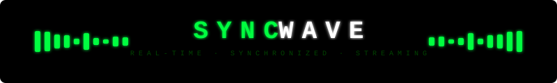

<div align="center">
  
</div>

<div align="center">
  
</div>

<br/>

<div align="center">

[](https://reactjs.org/)
[](https://www.typescriptlang.org/)
[](https://vitejs.dev/)
[](https://socket.io/)
[](https://tailwindcss.com/)
[](https://www.framer.com/motion/)
[](LICENSE)

</div>

<div align="center">
  
</div>

---

## ◈ Overview

**SyncWave** is a real-time synchronized YouTube streaming platform. Create a room, share a six-character code, and watch any YouTube video in perfect sync with friends — no accounts, no downloads, no lag.

The host controls playback (play, pause, seek, skip). Every listener automatically snaps to the same timestamp via latency-compensated synchronization over WebSockets. The aesthetic is uncompromisingly cyberpunk: monospace fonts, neon-green glows, and scanline overlays.

---

## ◈ Features

| Feature | Description |
|---|---|
| ⚡ **Instant Rooms** | Create a room in one click — get a shareable 6-character code |
| 🔄 **Real-Time Sync** | Latency-compensated playback keeps every listener frame-perfect |
| 🎬 **YouTube Integration** | Paste any YouTube URL or video ID to load content |
| 👥 **Multi-User** | See all connected devices in the room live |
| 🎛️ **Host Controls** | Play, pause, seek, ±10 s skip — full control for the host |
| 🔊 **Volume & Mute** | Per-client volume and mute controls |
| 🔗 **Deep Links** | Share a direct link that auto-fills the room code |
| 🚫 **No Account** | Zero sign-up or login required |
| 🎨 **Cyberpunk UI** | Animated waveform, scanline overlay, neon-glow aesthetic |
| ♻️ **Auto Host Transfer** | If the host disconnects, control passes to the next user |

---

## ◈ Demo

> **TODO:** Add a screenshot or screen-recording GIF here once the app is deployed.
>
> Suggested path: `assets/demo.gif`

<!-- Uncomment and replace with actual demo once available:
<div align="center">
  
</div>
-->

**Quick preview — what you'll see:**

```
┌──────────────────────────────────────────────────┐
│  ● CONNECTED            ROOM  AB3X9F   [🔗] [✕] │
│  SYNCWAVE                                         │
│  [ HOST ]                     USER :: NEON_WOLF   │
│ ┌────────────────────────────────────────────────┐│
│ │           [ YouTube Player ]                   ││
│ └────────────────────────────────────────────────┘│
│  ▂▄▆█▆▄▂▁▂▄▇█▇▄▂  ← animated waveform           │
│  ──────●─────────────────  0:42 / 3:28            │
│  |◀  ▶  ▶|   🔊 ████░░░                           │
│                                                   │
│  CONNECTED DEVICES                                │
│  ★ NEON_WOLF (you)  ·  CYBER_SYNC  ·  VOID_PULSE  │
└──────────────────────────────────────────────────┘
```

---

## ◈ Tech Stack

<div align="center">

| Layer | Technology |
|---|---|
| **Frontend** | React 18 + TypeScript + Vite |
| **Styling** | Tailwind CSS + Framer Motion |
| **Realtime** | Socket.io (client + server) |
| **Backend** | Node.js + Express |
| **Icons** | Lucide React |
| **Database** | Supabase *(optional / future)* |

</div>

---

## ◈ Getting Started

### Prerequisites

- **Node.js** ≥ 18
- **npm** ≥ 9

### Installation

```bash
# 1. Clone the repository
git clone https://github.com/hardik44ss/SyncWave.git
cd SyncWave

# 2. Install frontend dependencies
npm install

# 3. Install server dependencies
cd server && npm install && cd ..
```

### Running Locally

Open **two terminals**:

```bash
# Terminal 1 — start the Socket.io server (default: port 3001)
cd server
node index.js
```

```bash
# Terminal 2 — start the Vite dev server (default: port 5173)
npm run dev
```

Then open [http://localhost:5173](http://localhost:5173) in your browser.

---

## ◈ Configuration

The frontend connects to the Socket.io server via the URL configured in `src/lib/socket.ts`.

| Variable | Default | Description |
|---|---|---|
| `VITE_SOCKET_URL` | `http://localhost:3001` | WebSocket server URL |

Create a `.env` file at the root to override:

```env
VITE_SOCKET_URL=https://your-server.example.com
```

The server reads `PORT` from the environment (default `3001`):

```env
PORT=3001
```

---

## ◈ Usage

1. **Open the app** in your browser.
2. **Set your callsign** (random alias auto-generated, or type your own).
3. **Create a room** — a 6-character code is displayed.
4. **Share the code** (or the auto-generated deep link via the copy button) with friends.
5. **Paste a YouTube URL** into the video input field as the host.
6. **Press play** — all listeners sync instantly.

> **Listeners** can adjust their own volume/mute but cannot control playback.
> **Host** has full playback controls. If the host leaves, the next connected user becomes host.

---

## ◈ Architecture

```
Browser (React + Vite)
    │
    │  Socket.io events
    ▼
Node.js Server (Express + Socket.io)
    │
    ├── create-room   → generates room ID, stores state
    ├── join-room     → joins Socket.io room, receives sync state
    ├── play/pause    → host-only; broadcasts to all members
    ├── seek          → host-only; broadcasts timestamp
    ├── change-video  → host-only; resets state, broadcasts new video ID
    └── sync-request  → any client can re-sync on reconnect
```

Latency compensation is calculated on the client using a `ping-server` round-trip measurement — playback position is adjusted by half the measured RTT before seeking.

---

## ◈ Project Structure

```
SyncWave/
├── src/
│   ├── components/       # UI components (Controls, Waveform, ProgressBar, …)
│   ├── hooks/            # useYouTube, useSync
│   ├── lib/              # socket singleton
│   ├── pages/            # Home, Room
│   └── types/            # Shared TypeScript types
├── server/
│   └── index.js          # Express + Socket.io server
├── assets/               # README assets (SVG, GIF)
├── index.html
├── vite.config.ts
└── tailwind.config.js
```

---

## ◈ Roadmap

- [ ] 🎵 Support for additional streaming platforms (Spotify, SoundCloud)
- [ ] 💬 In-room chat / reactions
- [ ] 📋 Collaborative queue / playlist management
- [ ] 🔐 Optional password-protected rooms
- [ ] 📱 Mobile-responsive improvements
- [ ] 🌐 Persistent rooms via Supabase
- [ ] 🎨 Theming / alternate UI skins

---

## ◈ Contributing

Contributions are welcome! Please follow these steps:

1. **Fork** the repository
2. **Create** a feature branch: `git checkout -b feature/my-feature`
3. **Commit** your changes: `git commit -m 'feat: add my feature'`
4. **Push** to the branch: `git push origin feature/my-feature`
5. **Open** a Pull Request

Please ensure your code passes `npm run lint` and `npm run typecheck` before submitting.

---

## ◈ License

Distributed under the **MIT License**. See [`LICENSE`](LICENSE) for details.

---

## ◈ Contact

**Hardik** — [@hardik44ss](https://github.com/hardik44ss)

Project Link: [https://github.com/hardik44ss/SyncWave](https://github.com/hardik44ss/SyncWave)

---

<div align="center">
  
  <sub>Built with ♥ and a lot of <code>#00ff41</code></sub>
</div>
